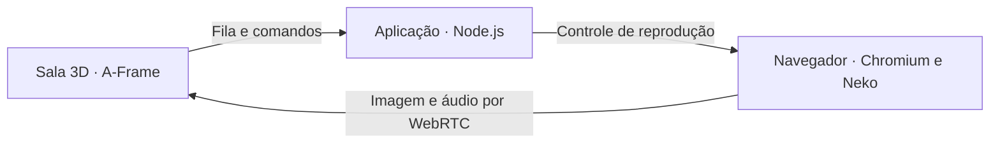

# Side by Side

**Cinema virtual para assistir junto, de onde cada pessoa estiver.**

O Side by Side é um projeto acadêmico de Computação que leva uma sessão de cinema entre amigos para o navegador. O grupo entra na mesma sala 3D, escolhe o que assistir no YouTube e vê o vídeo no telão. A ideia é recriar a sensação de dividir a sala, com seis poltronas e uma fila que todo mundo pode organizar.

## A experiência

- **Um telão, uma sessão.** Quando alguém pausa, avança ou escolhe outro vídeo, a mudança vale para toda a sala.
- **Fila compartilhada.** Pesquise no YouTube ou cole o link de um vídeo. Dá para reorganizar a fila e voltar aos vídeos do histórico.
- **Seu lugar no cinema.** Escolha uma das seis poltronas e ajuste luz e volume no seu dispositivo.
- **Do navegador ao Cardboard.** No computador, arraste a cena para olhar ao redor. No celular compatível, entre no modo VR e mantenha o olhar sobre os botões para usar os controles dentro da sala.

## Como funciona

A cena 3D usa A-Frame. O servidor Node.js mantém a fila e envia comandos para um Chromium executado no Neko. O Neko transmite a imagem e o áudio desse navegador por WebRTC, e a cena usa a imagem recebida no telão. Os participantes assistem à mesma reprodução do servidor.



## Como rodar localmente

Você precisa do **Docker com contêineres Linux** e do **Docker Compose 2.24.4 ou superior**. No Windows, use o Docker Desktop. Esta configuração abre o cinema apenas no computador que estiver rodando os contêineres.

1. Clone o repositório e copie o arquivo de exemplo. No Windows, os comandos abaixo funcionam no Git Bash.

   ```bash
   git clone https://github.com/erick-henrick/SidebySide.git
   cd SidebySide
   cp .env.example .env
   ```

2. No `.env`, preencha `PUBLIC_ORIGIN=http://127.0.0.1:3114` e `MEDIA_ADDRESS=127.0.0.1`. Para `CONTROL_TOKEN`, `VIEWER_PASSWORD` e `ADMIN_PASSWORD`, use três valores aleatórios diferentes. Você pode gerar cada um com `openssl rand -hex 32`. Mantenha `ICE_SERVERS=[]` para esse teste. O arquivo `.env` fica na sua máquina.

3. Crie o arquivo `compose.local.yaml` ao lado do `compose.yaml` para publicar o site e a mídia no endereço local.

   ```yaml
   services:
     app:
       ports:
         - "127.0.0.1:3114:3114"
     browser:
       ports: !override
         - "127.0.0.1:60200-60219:60200-60219/udp"
   ```

4. Suba os serviços e abra [o Side by Side](http://127.0.0.1:3114/). A primeira execução baixa as imagens dos contêineres.

   ```bash
   docker compose -f compose.yaml -f compose.local.yaml up --build -d --wait
   ```

   Para encerrar a sessão local e manter a fila salva no volume:

   ```bash
   docker compose -f compose.yaml -f compose.local.yaml down
   ```

## Deploy no Coolify

1. Crie uma aplicação com **Docker Compose** apontando para a branch `main`. Use `/` como diretório base e `/compose.yaml` como caminho do arquivo.
2. Configure um domínio HTTPS no serviço `app`, apontando para a porta interna `3114`.
3. Nas variáveis do Coolify, ajuste `PUBLIC_ORIGIN` para o endereço HTTPS que o visitante abre no navegador e `MEDIA_ADDRESS` para o IPv4 público da VM. Mantenha `ICE_SERVERS=[]` para o primeiro teste. O Coolify gera o token e as duas senhas a partir das referências `SERVICE_PASSWORD_64_*` do Compose.
4. Libere as portas TCP `80` e `443` para o proxy e UDP `60200–60219` para a mídia. Faça o deploy e teste o telão e o som em dois dispositivos.

Para detalhes de rede e configuração, veja o [guia de deploy](LEIA-ME.md). Os créditos da foto e das texturas estão em [`web/assets/credits.json`](web/assets/credits.json).
